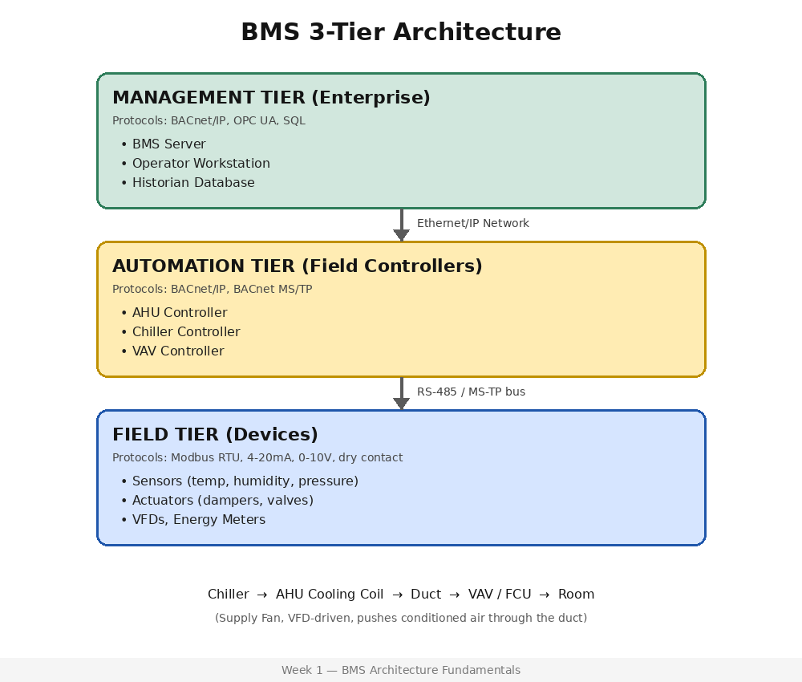

# Week 1 — BMS/BAS Architecture Fundamentals

## Overview
Documented the 3-tier BMS architecture (Management / Automation / Field)
and built an IO point reference list as foundation for the BACnet and
Modbus labs in Weeks 2-3.

## Architecture Diagram

## IO Point List
See [io-point-list.csv](io-point-list.csv) — 20 sample points classified
as AI/AO/BI/BO with real-world examples (SAT, CHW temp, damper %,
valve %, fan status, filter alarm, etc.)

## Glossary
See [glossary.md](glossary.md) for BMS, BAS, AHU, FCU, Chiller, VAV,
VFD, DDC definitions.

## Key Learning
- BMS 3-tier architecture maps directly to network layering
  (management/distribution/access)
- VFDs save energy via the cube-law relationship between speed and power
- Every BMS point is classified by I/O type before becoming a
  BACnet/Modbus object (next week)

## Screenshots

