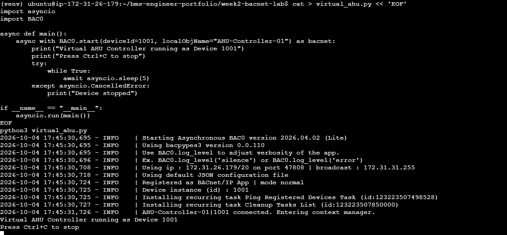
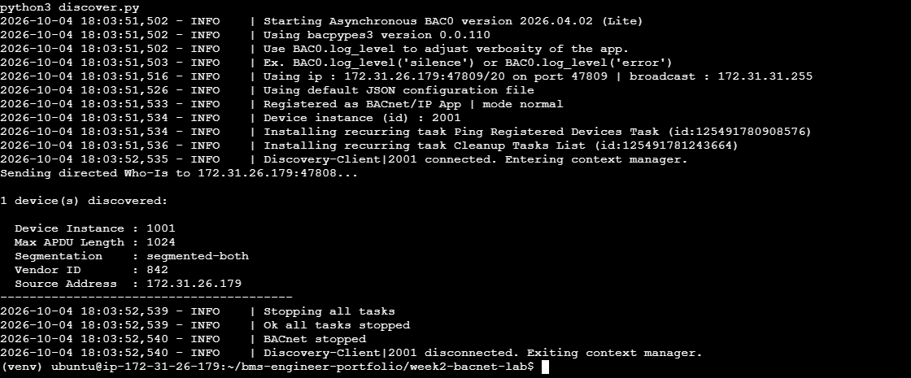
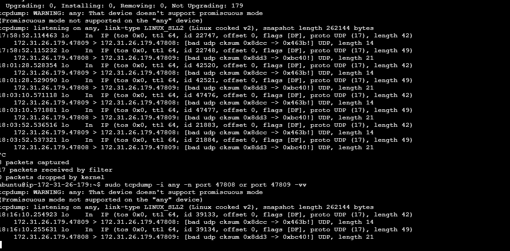

# Week 2 — BACnet/IP Fundamentals

## Overview
Built a virtual BACnet/IP device (simulated AHU controller) using Python
(BAC0 library) on an AWS EC2 instance, performed Who-Is/I-Am discovery,
and verified the traffic at the packet level using tcpdump.

## What Was Built
- `virtual_ahu.py` — simulates a BACnet/IP device (Device Instance 1001,
  object name "AHU-Controller-01")
- `discover.py` — sends a directed Who-Is request and parses the I-Am
  response (Device Instance, Max APDU Length, Segmentation, Vendor ID)

## BACnet Concepts Covered

**BACnet:** A communication protocol for building automation devices
(ANSI/ASHRAE 135). Two variants: BACnet/IP (Ethernet, UDP port 47808)
and BACnet MS/TP (RS-485 serial).

**Device:** A BACnet-compliant controller, identified on the network by
a unique Device Instance number.

**Object:** A single data point within a device (sensor or actuator),
identified by Object Type + Instance (e.g. AI:1).

**Who-Is / I-Am:** Who-Is is a broadcast (or directed) request used to
discover BACnet devices on a network. I-Am is the response, announcing
a device's instance number, address, max APDU length, segmentation
support, and vendor ID — conceptually similar to an ARP request/reply.

**ReadProperty / WriteProperty:** Services used to read or write a
value on a BACnet object's property (e.g. PresentValue).

## Real-World Troubleshooting Encountered

- **AWS VPC does not support Layer-2 broadcast/multicast traffic** —
  the standard broadcast Who-Is never reached the target device.
  Fixed by switching to a **directed (unicast) Who-Is** sent straight
  to the device's IP:port. This mirrors a real constraint faced when
  deploying BACnet systems in cloud/virtualized environments.
- Running two BACnet/IP apps on the same host requires **different
  UDP ports**, since BACnet/IP binds one socket per IP:port — the
  device app used 47808, the discovery client used 47809.
- The `who_is()` call in BAC0 2026.x returns the list of I-Am responses
  directly from the coroutine — this needed to be captured from the
  return value rather than read from a `devices`/`discoveredDevices`
  property, which stayed empty since no separate registration step
  was triggered.

## Discovery Output

```
Sending directed Who-Is to 172.31.26.179:47808...

1 device(s) discovered:

  Device Instance : 1001
  Max APDU Length : 1024
  Segmentation    : segmented-both
  Vendor ID       : 842
  Source Address  : 172.31.26.179
```

## Packet-Level Verification (tcpdump)

Confirmed the full Who-Is / I-Am exchange at the UDP level:

```
172.31.26.179.47809 > 172.31.26.179.47808: UDP, length 14   (Who-Is)
172.31.26.179.47808 > 172.31.26.179.47809: UDP, length 21   (I-Am)
```

## Key Learning

- BACnet device/object model maps directly to the IO point
  classification done in Week 1 (AI/AO/BI/BO)
- Who-Is/I-Am discovery is the BACnet equivalent of ARP — first step
  in any BMS commissioning process
- Cloud-hosted BACnet labs need directed communication, since
  standard LAN broadcast assumptions don't hold in a VPC
- BACnet/IP always uses UDP port 47808 (0xBAC0) by default

## Screenshots




