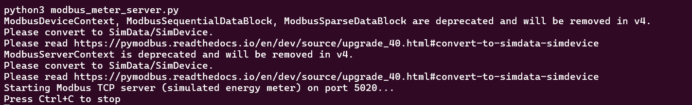
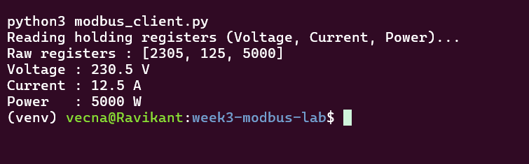
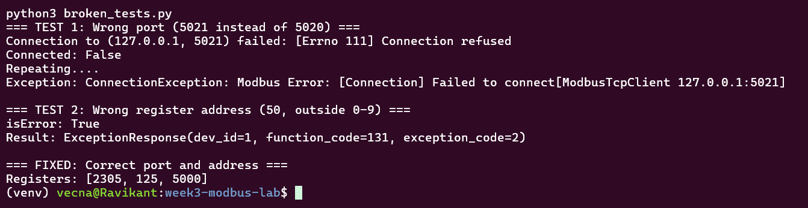

# Week 3 — Modbus TCP Fundamentals

## Overview
Built a simulated Modbus TCP energy meter in Python (pymodbus 3.16), read
voltage, current and power from holding registers using Function Code 03,
and documented a break-and-fix troubleshooting exercise.

## What Was Built
- `modbus_meter_server.py` — simulated energy meter (Modbus TCP, port 5020)
- `modbus_client.py` — reads the holding registers with Function Code 03
- `broken_tests.py` — deliberately wrong port and register address, then the fix

## Modbus Concepts Covered
- Modbus TCP (Ethernet, port 502) vs Modbus RTU (RS-485 serial)
- Master/slave model: no device discovery, the master must already know the
  address and register map (unlike BACnet Who-Is/I-Am)
- Four data types and their BACnet equivalents:

| Modbus | Access | BACnet equivalent |
|---|---|---|
| Coil | Read/Write, 1 bit | BO |
| Discrete Input | Read-only, 1 bit | BI |
| Holding Register | Read/Write, 16 bit | AO |
| Input Register | Read-only, 16 bit | AI |

## Register Map (this project)

| Register Address | Value | Scaling |
|---|---|---|
| 0 | Voltage | ÷10 (2305 = 230.5 V) |
| 1 | Current | ÷10 (125 = 12.5 A) |
| 2 | Power | ×1 (5000 = 5000 W) |

## Successful Read

```
Raw registers : [2305, 125, 5000]
Voltage : 230.5 V
Current : 12.5 A
Power   : 5000 W
```

## Break-and-Fix Exercise

| Test | Result | Diagnosis |
|---|---|---|
| Wrong port (5021) | `Connection refused` / `ConnectionException` | Device never reached: network or port problem |
| Wrong register (address 50) | `ExceptionResponse(function_code=131, exception_code=2)` | Device reached, but Illegal Data Address: register map problem |

Function code 131 is 0x83, which is FC03 (0x03) with the error flag (0x80) set.

## Real-World Issues Encountered
- pymodbus 3.16 renamed `ModbusSlaveContext` to `ModbusDeviceContext`; the
  server code handles both names.
- `ModbusSequentialDataBlock` is 1-based internally: a start address of 0
  raised `TypeError: 0 <= address < 65535`. Starting the block at 1 lets the
  client read address 0 correctly.
- Used port 5020 instead of 502, since ports below 1024 need root.

## Key Learning
- A connection failure and a Modbus exception response point to different
  layers: check network/port first, then the register map.
- Register scaling (÷10) and 0-based vs 1-based addressing vary by device and
  must be checked in the meter's documentation.
- Function Code 03 (Read Holding Registers) is the most common call for
  energy meter integration.

## Screenshots



