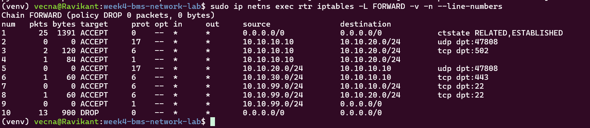

# Week 4 - Segmented BMS Network (VLANs + ACL)

## Overview
Built a segmented BMS network on Linux network namespaces: a VLAN-aware
switch, router-on-a-stick inter-VLAN routing, and a default-deny stateful ACL.
Only the BMS server can reach the controllers (BACnet UDP 47808, Modbus TCP 502);
IT users get the dashboard (TCP 443) and nothing else. Verified with
allowed-versus-blocked tests and a real Modbus read across VLANs.

## Topology


| VLAN | Subnet | Hosts |
|---|---|---|
| 10 | 10.10.10.0/24 | BMS server (10.10.10.10) |
| 20 | 10.10.20.0/24 | AHU controller (.11), Chiller controller (.12) |
| 30 | 10.10.30.0/24 | IT PC (10.10.30.10) |
| 99 | 10.10.99.0/24 | Management PC (10.10.99.10) |

Controllers use static addresses. The router holds the .1 gateway of every VLAN
on an 802.1Q trunk (trunk.10, trunk.20, trunk.30, trunk.99).


## ACL Policy (router FORWARD chain, default DROP)

| Source | Destination | Allowed |
|---|---|---|
| BMS server | Controllers (VLAN 20) | UDP 47808, TCP 502, ICMP |
| Controllers | BMS server | UDP 47808 only (alarms, COV) |
| IT users (VLAN 30) | BMS server | TCP 443 only |
| Management (VLAN 99) | BMS server, controllers | TCP 22, ICMP |
| Any | Any | Return traffic of allowed sessions only |

Everything else is dropped, including IT PC to controllers.

## Before the ACL
Without any ACL, the IT PC could ping the controllers across VLANs. BACnet and
Modbus have no authentication, so reachability alone is enough to send commands.


## Policy Test Results

```
BMS server -> AHU ping                         expect=ALLOW got=ALLOW PASS
BMS server -> Chiller Modbus TCP 502           expect=ALLOW got=ALLOW PASS
IT PC -> BMS dashboard TCP 443                 expect=ALLOW got=ALLOW PASS
Mgmt PC -> AHU port 22 (simulated)             expect=ALLOW got=ALLOW PASS
IT PC -> AHU ping                              expect=BLOCK got=BLOCK PASS
IT PC -> Chiller Modbus TCP 502                expect=BLOCK got=BLOCK PASS
IT PC -> BMS server ping                       expect=BLOCK got=BLOCK PASS
AHU -> BMS server ping                         expect=BLOCK got=BLOCK PASS
```




## Modbus Across VLANs
From the BMS server, a Modbus TCP read of the chiller meter succeeds
(230.5 V, 12.5 A, 5000 W). The same read from the IT PC fails with
`Connection to (10.10.20.12, 502) failed: timed out`.


## Troubleshooting Ladder

| Layer | Question | Check |
|---|---|---|
| L1/L2 | Link up, correct VLAN? | `ip -br link`, `bridge vlan show` |
| L2 | ARP resolving? | `ip neigh` |
| L3 | Gateway and route correct? | `ip route`, ping the .1 gateway |
| Router | Forwarding enabled? | `sysctl net.ipv4.ip_forward` |
| ACL | Did a rule drop it? | `iptables -L FORWARD -v -n`, watch the DROP counter |
| App | Service listening? | `ss -ltnp`, Modbus exception response |

## Key Learning
- A blocked connection (ACL DROP) ends in a timeout, while a closed port is
  refused immediately (Week 3). The symptom tells you whether to check the ACL
  or the service.
- Default deny plus least privilege: open only the exact source, destination
  and port each flow needs.
- BACnet/IP broadcasts do not cross routers, so multi-subnet sites need a BBMD
  or directed (unicast) addressing, the same limit seen on AWS VPC in Week 2.
- Segmentation is the main protection for BACnet/IP and Modbus TCP because
  neither authenticates or encrypts by default.
