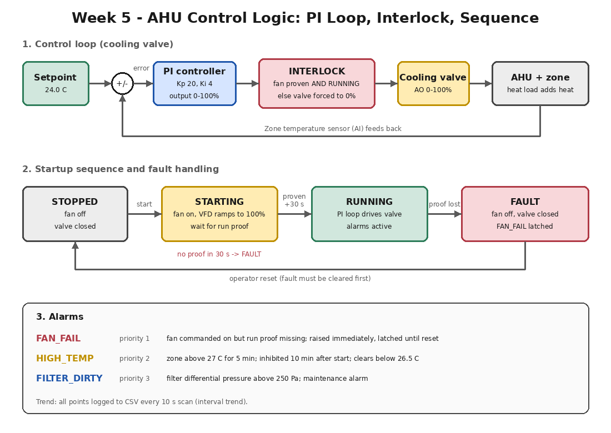
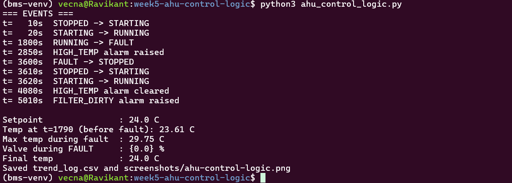
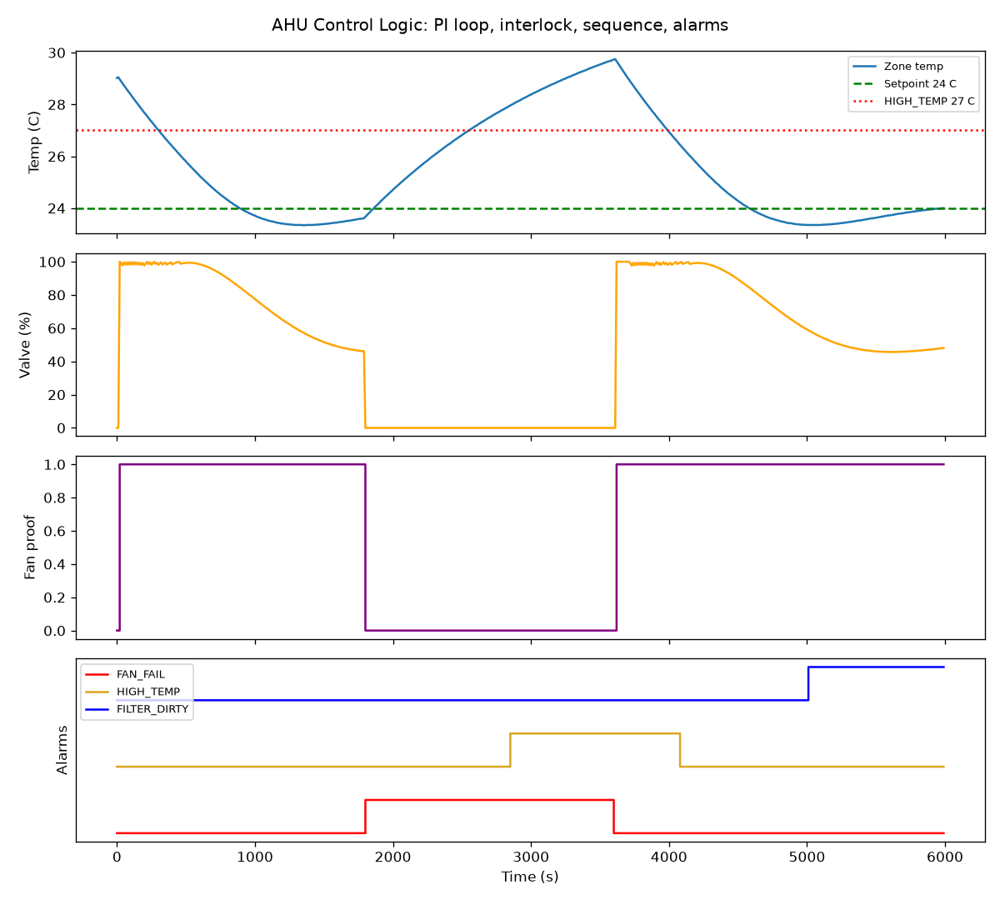

# Week 5: AHU Control Logic

## Overview
Simulated an air handling unit cooling loop in Python: a PI controller drives a
chilled water valve, a fan-proof interlock protects the coil, a four-state
startup sequence handles faults, and three prioritised alarms are raised and
logged to a CSV trend. A fan failure is injected at t=1800 s to test the logic.

## Control Design

| Element | Behaviour |
|---|---|
| Setpoint | 24.0 C zone temperature |
| Controller | PI, Kp 20, Ki 4, output 0-100% valve (AO) |
| Anti-windup | Integral only accumulates while the output is not saturated |
| Interlock | Valve forced to 0% unless fan is proven AND running |
| Sequence | STOPPED, STARTING, RUNNING, FAULT |
| Startup | Fan on, wait up to 30 s for run proof, otherwise FAULT |
| FAULT | Fan off, valve closed, FAN_FAIL latched until operator reset |

## Alarms
| Alarm | Priority | Condition |
|---|---|---|
| FAN_FAIL | 1 | Fan commanded on but run proof missing; immediate; latched until reset |
| HIGH_TEMP | 2 | Zone above 27 C for 5 min; inhibited 10 min after start; clears below 26.5 C |
| FILTER_DIRTY | 3 | Filter differential pressure above 250 Pa (maintenance alarm) |

## Test Result
Fault injected: fan proof lost from t=1800 s, operator reset at t=3600 s.

| Time | Event |
|---|---|
| 20 s | STARTING to RUNNING (fan proof received) |
| 1800 s | RUNNING to FAULT, FAN_FAIL latched, valve forced to 0% |
| 2850 s | HIGH_TEMP raised (zone above 27 C for 5 min) |
| 3600 s | Operator reset, restart sequence, back to RUNNING |
| 4080 s | HIGH_TEMP cleared below 26.5 C |
| 5010 s | FILTER_DIRTY raised |

Zone temperature was 23.6 C before the fault, peaked at 29.75 C with the fan
down, and returned to the 24.0 C setpoint after restart. The valve stayed at 0%
for the whole FAULT state.

## Files
- `ahu_control_logic.py`: simulation (room model, PI, interlock, sequence, alarms)
- `trend_log.csv`: interval trend, one row per 10 s scan

## Key Learning
- An interlock acts immediately; an alarm gets a delay and a start-up inhibit so
  normal transients do not cause nuisance alarms.
- Hysteresis (alarm at 27 C, clear at 26.5 C) stops the alarm from chattering.
- A latched fault needs an operator reset after the cause is fixed, so the AHU
  never restarts by itself into a fault condition.
- Anti-windup keeps the integral term from growing while the valve is saturated.
- Trend logs are the first thing to read when troubleshooting a control loop.
