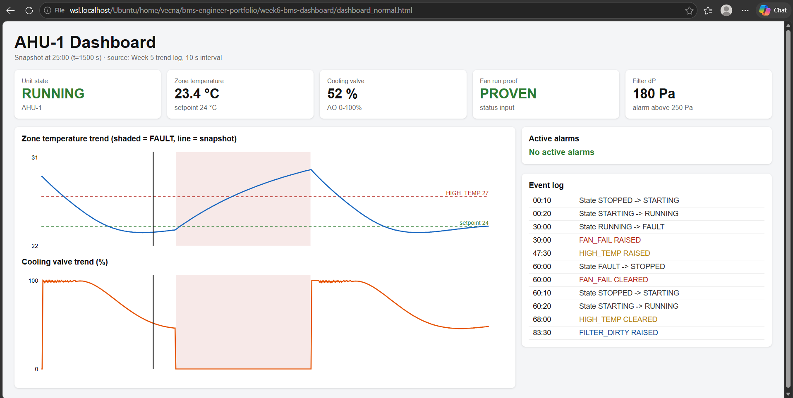
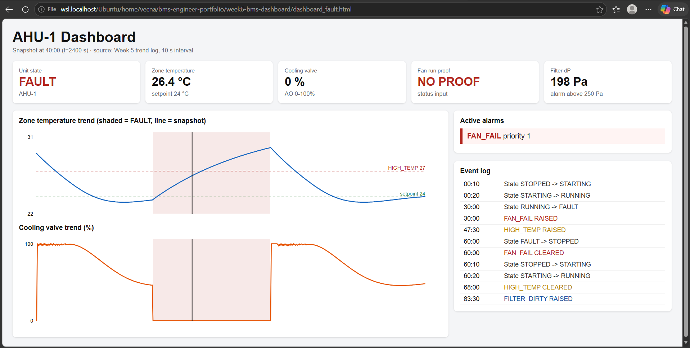

# Week 6: BMS Dashboard

## Overview
Built a dashboard generator in Python that reads the Week 5 AHU trend log
(10 s interval) and writes a self-contained HTML page: status tiles, active
alarm panel, zone temperature and valve trends, and an event log. Only the
Python standard library is used.

## How to Run

    python3 bms_dashboard.py 1500 dashboard_normal.html
    python3 bms_dashboard.py 2400 dashboard_fault.html

The first argument is the snapshot time in seconds.

## Dashboard Elements
| Element | Source | Purpose |
|---|---|---|
| Unit state tile | state column | STOPPED / STARTING / RUNNING / FAULT, colour coded |
| Zone temperature tile | AI | Turns red above the 27 C HIGH_TEMP limit |
| Cooling valve tile | AO | 0-100% command |
| Fan run proof tile | status input | PROVEN or NO PROOF |
| Filter dP tile | AI | Maintenance alarm above 250 Pa |
| Active alarms | alarm flags | Sorted by priority, colour coded |
| Trends | CSV | Temperature and valve, FAULT shaded, snapshot marker |
| Event log | state and alarm changes | Timestamped sequence of events |

## Normal Operation (t = 1500 s)

State RUNNING, zone 23.4 C against the 24 C setpoint, valve at about 52%,
fan proven, no active alarms.

## Fault Condition (t = 2400 s)

State FAULT, valve forced to 0%, fan shows NO PROOF and FAN_FAIL (priority 1)
is the only active alarm. The zone has already risen to 26.4 C; HIGH_TEMP
follows at 47:30 once it has stayed above 27 C for 5 minutes.

## Key Learning
- A dashboard should show state, cause and priority at a glance: the unit
  state tile and the FAN_FAIL alarm explain the fault before anyone reads a trend.
- Colour is reserved for abnormal conditions so alarms stand out.
- The event log gives the sequence of events (state change, then alarm), which
  is the first thing needed when diagnosing a fault.
- The trend shows how the zone drifted while the fan was down.
